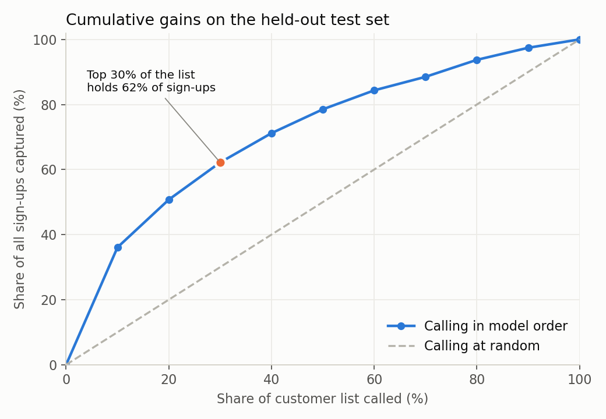
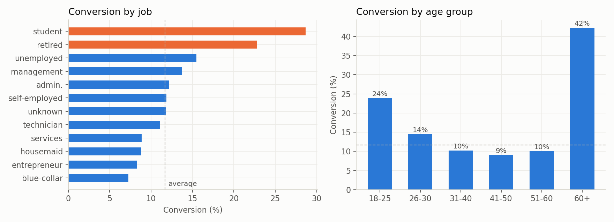
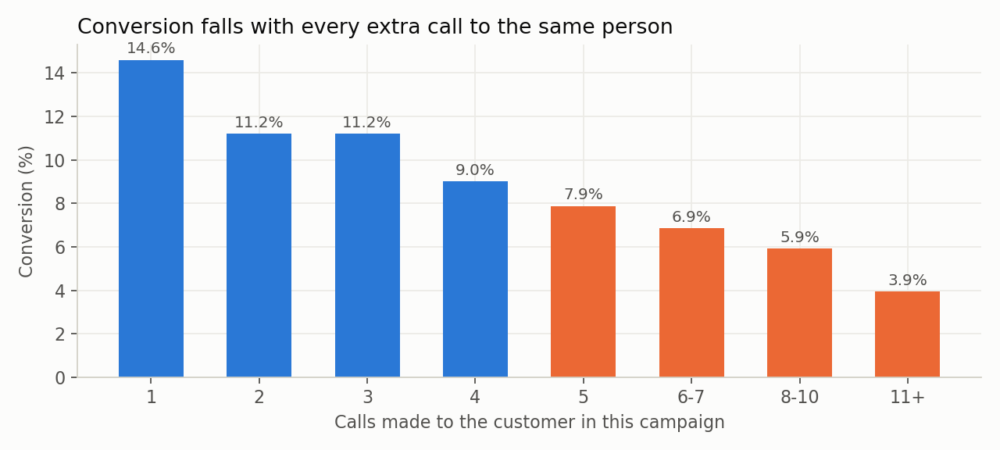
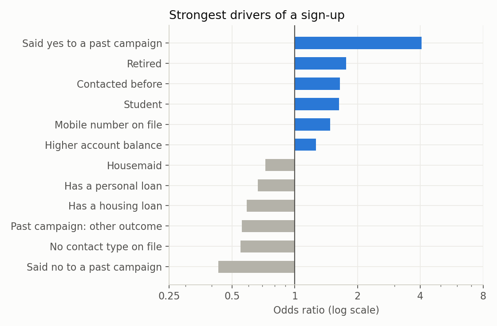

# Who should the bank call? Targeting a term-deposit campaign

A bank's phone campaign converted 11.7% of 45,211 calls. I built a model that ranks customers **before** anyone dials, so the next campaign can call the likeliest buyers first.

**Result:** calling the top half of the list in model order keeps 79% of sign-ups and cuts cost per sign-up from EUR 43 to EUR 27. Separately, people called five or more times used up 41% of all calls and gave only 7% of sign-ups.

**Tools:** Python (pandas, scikit-learn, matplotlib), Jupyter
**Notebook:** [campaign_targeting.ipynb](campaign_targeting.ipynb)



## The question

The bank calls everyone on the list and roughly 8 out of 9 calls go nowhere. If it could only afford to call part of the list next time, who should it call first, and how much would it lose by not calling the rest?

## Data

[UCI Bank Marketing](https://archive.ics.uci.edu/dataset/222/bank+marketing) (Moro, Cortez and Rita, 2014): 45,211 customers contacted by a Portuguese bank between May 2008 and November 2010. Each row has the customer's profile, their history with earlier campaigns, and whether they subscribed.

## Choices I made, and why

| Choice | Reason |
|---|---|
| Dropped `duration` (call length) | It's only known after the call ends. Including it pushes accuracy way up and makes the model useless for deciding who to call. This is the most common mistake people make with this dataset. |
| Kept `campaign`, `day`, `month` out of the model | They describe how the bank ran the campaign, not who the customer is, so they don't exist for a fresh call list. I analysed `campaign` separately instead. |
| Turned `pdays = -1` into a "contacted before" flag | -1 is a code meaning "never contacted", not a number of days. |
| Logistic regression over gradient boosting | Cross-validated ROC AUC was 0.739 against 0.753. Giving up 0.014 buys a model a marketing manager can read line by line. |
| Held out 25% as a test set | Model choice used 5-fold cross-validation on the other 75%. The test set was used once, at the end. |

## What I found

**1. Past buyers are gold, but there aren't many of them.** Customers who said yes to an earlier campaign convert at 65%. They're 3% of the list.

**2. The middle-aged middle of the list converts worst.** Students (29%) and retired customers (23%) are far above the 11.7% average. Most calls went to the 31 to 50 age band, which converts at 9 to 10%.



**3. Repeated calling is where the money leaks.** Conversion drops with every extra call to the same person, from 14.6% on the first call to 3.9% after eleven or more. Customers called five or more times took 41% of all calls and produced 7% of sign-ups.



**4. The model ranks well.** On the untouched test set (ROC AUC 0.747), the top 10% of scored customers converted at 42%, which is 3.6 times the average. The top 30% held 62% of all sign-ups.



## What it's worth

The data has no cost figures, so I assumed EUR 5 per call and EUR 80 margin per new deposit. The ranking doesn't depend on these, only the profit line does.

| Plan | Calls | Sign-ups kept | Cost per sign-up | Profit |
|---|---:|---:|---:|---:|
| Call top 20% | 2,260 | 51% | EUR 17 | EUR 42,380 |
| Call top 30% | 3,390 | 62% | EUR 21 | EUR 48,810 |
| Call top 50% | 5,651 | 79% | EUR 27 | EUR 54,785 |
| Call everyone (today) | 11,303 | 100% | EUR 43 | EUR 49,245 |

(Test set only, so a quarter of the full list.)

## Recommendation

1. **Call in score order and stop at the top half of the list.** About 11% more profit than calling everyone, with half the calls.
2. **Call past "yes" customers first, every time.**
3. **Cap attempts at four calls per person.** Move that capacity to new high-score customers.
4. **Prove it with a test before rolling it out.** Split the next list: half called in score order, half the old way, then compare cost per sign-up.

## Limitations

- 2008 to 2010 was the financial crisis, and this is one bank. The model would need retraining on recent data.
- The train/test split is random. A stricter test would train on earlier calls and score later ones.
- Cost and margin are assumptions.
- The four-call cap rests on a correlation. People who need many calls may just be harder to reach. Only the test in point 4 would settle it.

## Run it yourself

```bash
pip install pandas scikit-learn matplotlib jupyter
jupyter notebook campaign_targeting.ipynb
```

`campaign_targeting.py` is the same analysis as a plain script, for easy diffing.

Data licence: CC BY 4.0, UCI Machine Learning Repository.
